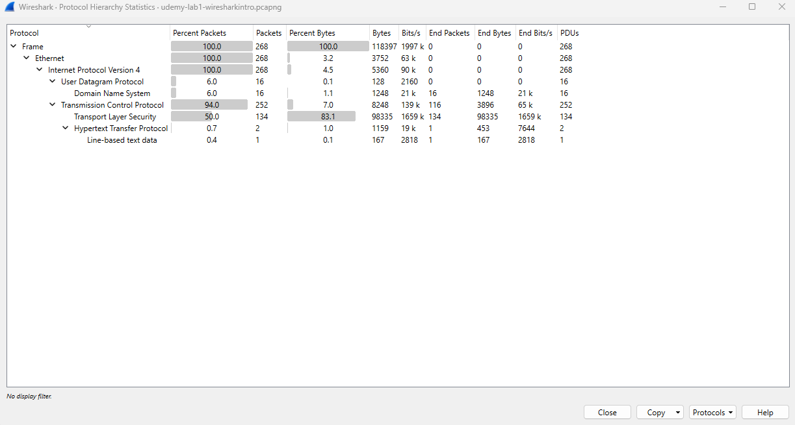
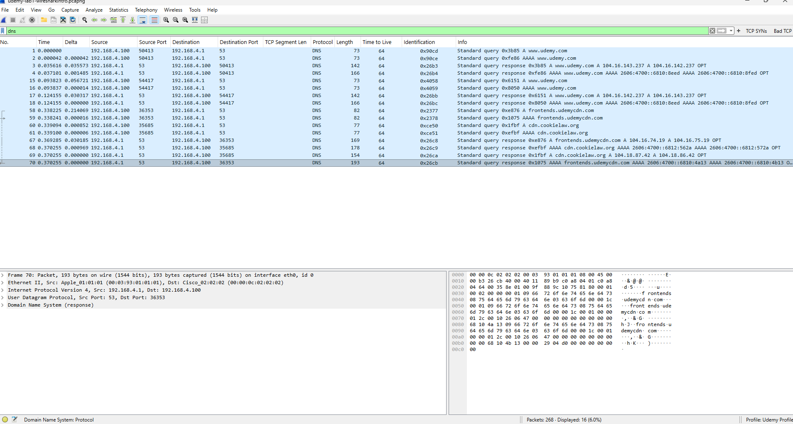
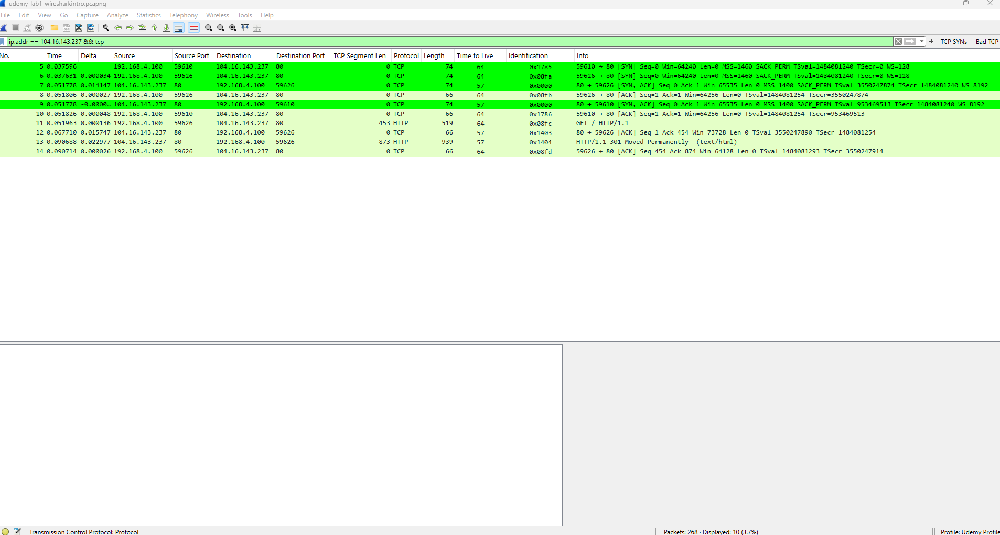
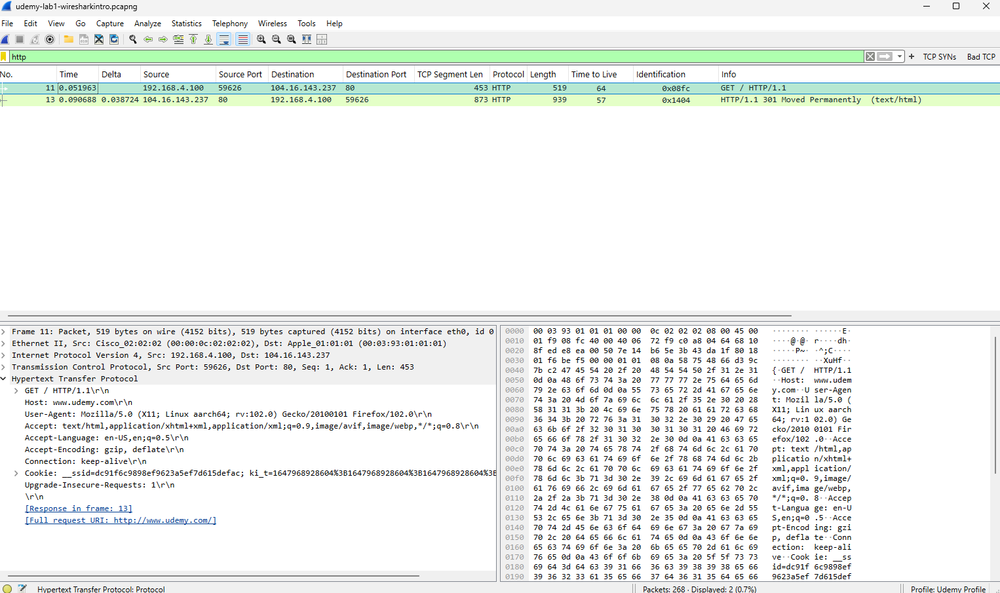
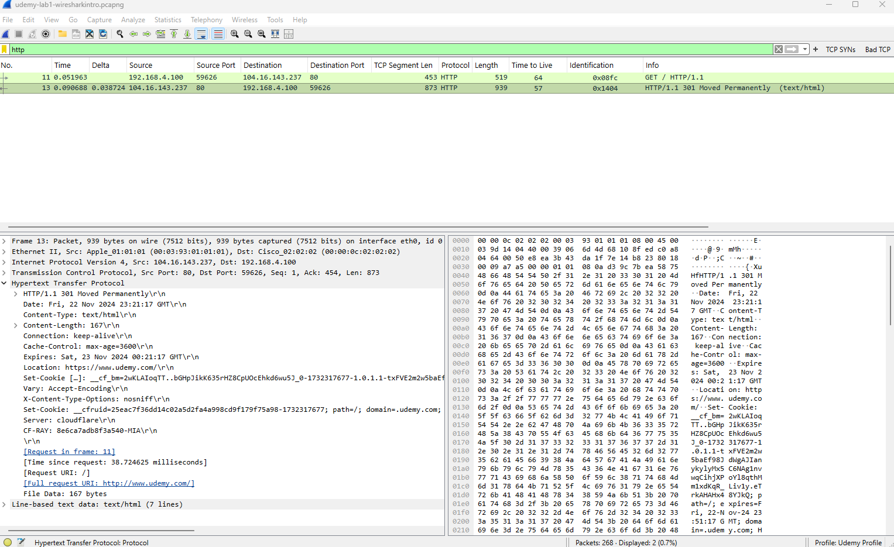
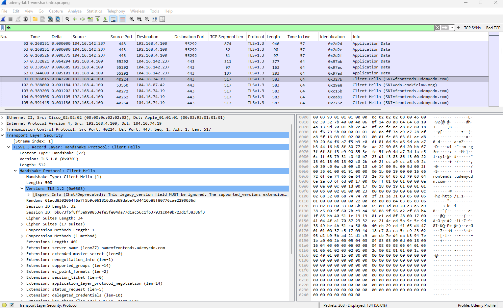

# Wireshark Network Traffic Investigation

## 1. Investigation Objective

The objective of this lab was to analyze a packet capture with Wireshark from a SOC analyst perspective.

The investigation focused on:

- Identifying the main network hosts and protocols
- Analyzing DNS resolution
- Examining TCP connection establishment
- Investigating HTTP traffic
- Analyzing TLS communication
- Correlating DNS, TCP, HTTP, and TLS activity
- Determining whether the observed traffic showed obvious indicators of malicious activity

The goal was not only to inspect individual packets, but to correlate multiple network events and reconstruct the communication flow.

---

## 2. Environment & Tools

**Tool:** Wireshark  
**Capture format:** PCAPNG  
**Total packets:** 268

Main Wireshark features used:

- Display filters
- Protocol Hierarchy
- Conversations
- Packet Details
- TCP flag analysis
- DNS analysis
- HTTP analysis
- TLS handshake analysis

Useful display filters used during the investigation:

```text
dns
http
tls
tcp.flags.syn == 1 && tcp.flags.ack == 0
ip.addr == 104.16.143.237 && tcp
```


## 3. Capture Overview

The Protocol Hierarchy showed that the capture contained 268 packets.
Important protocol observations included:
Protocol	Packets	Percentage
IPv4	268	100%
TCP	252	94%
UDP	16	6%
DNS	16	6%
TLS	134	50%
HTTP	2	0.7%


The capture was therefore dominated by TCP traffic, with a significant amount of TLS-encrypted communication.


 
## 4. Protocol and Conversation Analysis

IPv4 conversation analysis identified 192.168.4.100 as the main internal endpoint in the capture.
It communicated with the following systems:
Internal Host	Remote Host	Packets	Bytes
192.168.4.100	104.16.74.19	148	60 KB
192.168.4.100	104.16.142.237	55	34 KB
192.168.4.100	104.16.143.237	10	2 KB
192.168.4.100	104.18.87.42	39	20 KB
192.168.4.100	192.168.4.1	16	2 KB


The communication with 192.168.4.1 was later identified as DNS traffic.
The external conversations primarily involved standard web traffic.


 
## 5. DNS Investigation

The following filter was used:
dns

The endpoint 192.168.4.100 sent DNS requests to 192.168.4.1 over UDP port 53.
Observed domain queries included:
www.udemy.com
frontends.udemycdn.com
cdn.cookielaw.org

For example, DNS resolution for www.udemy.com returned IPv4 addresses including:
104.16.143.237
104.16.142.237

The domain frontends.udemycdn.com resolved to addresses including:
104.16.74.19
104.16.75.19

The domain cdn.cookielaw.org resolved to addresses including:
104.18.87.42
104.18.86.42

Several of these IP addresses also appeared in the IPv4 Conversations view.
This allowed the DNS activity to be correlated with subsequent TCP connections.
No obvious indicators of DNS tunneling were observed in the analyzed DNS traffic.


 
## 6. TCP Connection Analysis

TCP SYN traffic was initially investigated using:
tcp.flags.syn == 1 && tcp.flags.ack == 0

Multiple SYN packets were observed from 192.168.4.100.
However, SYN packets alone are not sufficient evidence of port scanning.
A TCP conversation with 104.16.143.237 was examined in more detail using:
ip.addr == 104.16.143.237 && tcp

One connection used:
192.168.4.100:59626 → 104.16.143.237:80

The TCP three-way handshake was observed:
192.168.4.100:59626  → 104.16.143.237:80     SYN
104.16.143.237:80    → 192.168.4.100:59626   SYN, ACK
192.168.4.100:59626  → 104.16.143.237:80     ACK

This demonstrated a successful TCP connection establishment.
The capture also contained another TCP connection to the same server using source port 59610.



## Security Observation
The initial SYN activity could have been incorrectly interpreted as scanning if examined in isolation.
Further analysis showed communication with a small number of external hosts, primarily involving standard web services.
This demonstrated the importance of correlating multiple pieces of evidence before classifying network activity as malicious.


## 7. HTTP Investigation

The HTTP filter revealed two packets:
GET / HTTP/1.1
HTTP/1.1 301 Moved Permanently

The client sent:
192.168.4.100:59626
        →
104.16.143.237:80

The HTTP request contained:
GET / HTTP/1.1
Host: www.udemy.com

Because this communication used unencrypted HTTP, request information such as the host and HTTP headers was visible in the packet capture.



The server responded with:
HTTP/1.1 301 Moved Permanently

The response included:
Location: https://www.udemy.com/
Server: cloudflare

This showed that the HTTP request was redirected to HTTPS.
 
The observed sequence was:
http://www.udemy.com/
        ↓
HTTP GET /
        ↓
301 Moved Permanently
        ↓
Location: https://www.udemy.com/
        ↓
HTTPS



## 8. TLS Investigation

The following filter was used:
tls

The capture contained 134 TLS packets.
TLS Client Hello packets were observed from the internal endpoint to external servers over TCP port 443.
One example was:
192.168.4.100:40224
        →
104.16.74.19:443

Wireshark identified:
TLS Client Hello
SNI = frontends.udemycdn.com

Another Client Hello showed:
SNI = cdn.cookielaw.org

These hostnames were previously observed during the DNS investigation.
This provided another correlation:
DNS query
    ↓
Domain resolution
    ↓
TCP connection to resolved IP
    ↓
TLS Client Hello
    ↓
Associated hostname




The TLS application data itself was encrypted, demonstrating an important difference between HTTP and HTTPS analysis.
Even when application payloads are encrypted, useful network metadata may still be available, including:
- Source and destination IP addresses
- Source and destination ports
- Connection timing
- Traffic volume
- TLS handshake information
- SNI when visible in the captured TLS handshake

## 9. Security Assessment

Several possible security indicators were considered during the investigation.

## Port Scanning
Multiple SYN packets were initially observed.
However, further analysis showed a small number of external destinations and normal web-related communication.
The available evidence did not support classifying the activity as a port scan.

## DNS Tunneling
The DNS traffic consisted of recognizable web-related domain queries.
No obvious patterns such as unusually long random-looking subdomains or excessive DNS query activity were observed.
No obvious indicators of DNS tunneling were identified.

## Command and Control
The analyzed traffic did not show an obvious C2 or beaconing pattern.

## Data Exfiltration
No obvious network behavior indicating data exfiltration was identified within the analyzed capture.

## 10. Findings

The investigation identified the following network sequence:
192.168.4.100
        ↓
DNS query to 192.168.4.1
        ↓
Domain resolution
        ↓
TCP connection
        ↓
SYN → SYN-ACK → ACK
        ↓
HTTP GET
        ↓
HTTP 301 Redirect
        ↓
HTTPS / TCP 443
        ↓
TLS Client Hello
        ↓
Encrypted TLS application traffic

The DNS responses, TCP conversations, HTTP communication, and TLS connections were consistent with one another.
An important lesson from the investigation was that individual indicators should not be evaluated in isolation.
For example:
Multiple SYN packets
        ≠
Confirmed port scan

Additional context and correlation were required before reaching a conclusion.

## 11. Analyst Conclusion

No obvious malicious network activity was identified within the scope of the analyzed packet capture.
The observed traffic was consistent with normal web browsing activity involving Udemy and associated web resources.
The investigation demonstrated the importance of correlating DNS, TCP, HTTP, and TLS telemetry rather than making a security determination based on a single network indicator.

## 12. Skills Demonstrated

- Wireshark
- PCAP analysis
- TCP/IP analysis
- TCP three-way handshake analysis
- TCP flag analysis
- DNS investigation
- HTTP analysis
- HTTP redirect analysis
- TLS handshake analysis
- Network traffic correlation
- Basic threat identification
- Evidence-based security analysis